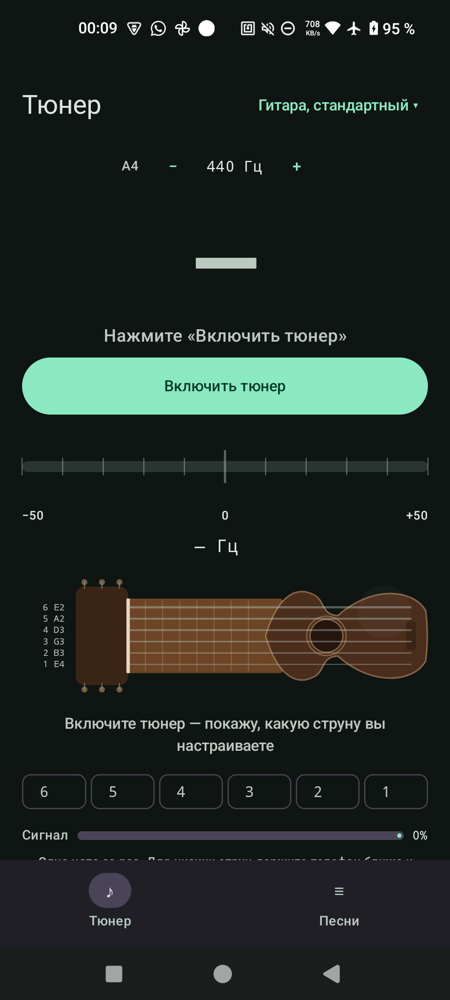

# Гитарный тюнер

Android-приложение для гитариста: тюнер по микрофону и библиотека песен с аккордами,
автопрокруткой, транспонированием и метрономом. Интерфейс на русском, аккаунт не нужен,
основные функции работают офлайн.

## Скачать и установить

**[Скачать APK 0.1.0](https://github.com/tcaramovmihail-gif/guitar-tuner/releases/latest/download/guitar-tuner-0.1.0.apk)**

- Android 8.0+ (minSdk 26).
- При установке разрешите установку из неизвестных источников.
- При первом запуске тюнера выдайте доступ к микрофону.
- Это тестовая сборка: APK подписан тестовым ключом Android Debug и не предназначен
  для публикации в RuStore. Для магазина понадобится отдельный release-ключ.

Все версии и заметки к релизам: [Releases](https://github.com/tcaramovmihail-gif/guitar-tuner/releases).

## Что умеет

### Тюнер

- Автоопределение активной струны по звуку микрофона.
- Удержание струны: подсветка не прыгает на одиночных выбросах и коротких обертонах.
- Ручной выбор струны тапом по грифу или чипами 6…1, возврат в режим «Авто».
- Стандартный гитарный строй, а также другие строи из `InstrumentTuning`.
- Калибровка A4 в диапазоне 430–450 Гц.
- Показ ноты, отклонения в центах, уровня сигнала и уверенности детектора.
- Если играет другая струна, приложение подсказывает это и не показывает ложные центы.

### Песни

- Локальная библиотека песен с аккордами.
- Папки по исполнителям и поиск.
- Импорт песен с AmDm: популярные подборки и поиск.
- Транспонирование аккордов.
- Автопрокрутка текста в темпе песни.
- Метроном с коротким деревянным стуком.

### Офлайн и приватность

- Библиотека, тюнер и метроном работают без сети.
- Сеть используется только во вкладке «Онлайн» для каталога AmDm.
- Аудио с микрофона обрабатывается на устройстве и никуда не отправляется.

## Скриншот



## Сборка из исходников

Нужны JDK 17 и Android SDK 36.

```powershell
git clone https://github.com/tcaramovmihail-gif/guitar-tuner.git
cd guitar-tuner

# Windows
.\gradlew.bat :app:assembleDebug

# Linux / macOS
./gradlew :app:assembleDebug
```

Готовый APK: `app/build/outputs/apk/debug/app-debug.apk`.

### Тесты и проверки

```powershell
.\gradlew.bat :core:model:test
.\gradlew.bat :core:dsp:test
.\gradlew.bat :core:catalog:test
.\gradlew.bat :app:lintDebug
.\gradlew.bat :app:assembleDebug
```

Compose-тесты на устройстве:

```powershell
.\gradlew.bat :app:connectedDebugAndroidTest
```

Тюнер проверяется на реальном телефоне: эмулятор не даёт достоверного микрофонного
сигнала. DSP-часть покрыта JVM-тестами на синтетических струнах, расстройке, шуме
и тишине.

## Структура проекта

| Путь | Назначение |
| --- | --- |
| `app/` | Compose UI, навигация, ViewModel, разрешения, экраны тюнера и песен |
| `core/model/` | Ноты, строи, транспонирование, `StringTracker` (Kotlin JVM) |
| `core/dsp/` | YIN-детектор, сглаживание, обработка сигнала (Kotlin JVM) |
| `core/audio/` | Захват PCM с микрофона и синтез метронома (Android library) |
| `core/catalog/` | HTTP-клиент и HTML-парсер AmDm (Kotlin JVM + Jsoup) |
| `docs/` | План, архитектура, среда разработки, правила агентов |
| `scripts/` | Скрипты сборки, установки и работы с устройством |

## Документация

- [План и критерии приёмки](docs/PLAN.md)
- [Архитектура](docs/ARCHITECTURE.md)
- [Среда разработки](docs/ENVIRONMENT.md)
- [Правила проекта](AGENTS.md)

## Статус

MVP в разработке. Сборка и JVM-тесты проходят. Тюнер и ручной выбор струны проверены
на реальном Android-устройстве; точность на живой гитаре продолжает проверяться.
`applicationId` `ru.eurovafel.guitartuner` может измениться до релиза в RuStore.
